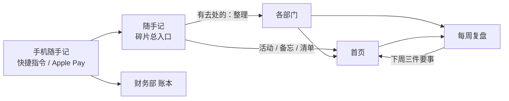

# 人生 OS · UI 设计规范（手绘粉绿风 v3 · Figma 定稿版）

> 来源：Figma 文件 https://www.figma.com/design/sDcsDbWq3AyNq2RnurREqo
> 读取日期：2026-11-19。2026-11-20 起视觉以 HTML 稿 `demo/v4/` 为准（Figma 已落后）；更早的 `demo/os/` 已过时。
> 以后改设计：先在 Figma 改，再更新这份文档，最后同步根目录的 `PRODUCT.md`（第 0 节）和 `DESIGN.md`（第 1–7 节），impeccable 只读那两份。

---

## 0. 系统逻辑：为什么有这么多板块

> 这一节是系统逻辑的唯一说明（最早的 2026-11-08 设计文档已删除），包含 2026-11-19 之后的决定（收件箱并入随手记、知识库分类、首页活动和 Reminder）。搭建步骤见 [2026-11-20 搭建计划](superpowers/plans/2026-11-20-life-os-build.md)。

### 0.1 出发点
- **问题：** 琐事太多，记录散在备忘录、收藏夹、聊天记录和脑子里，没有一个统一的地方。
- **思路：** 像管理一家公司一样管理自己。每件事都有归属的「部门」，每个部门只管自己那一摊，再由「总部」（首页）汇总、每周「开会」（复盘）。
- **真正起作用的是两个习惯：** 随手记（5 秒内记下）+ 定期复盘（每周日 20 分钟）。系统只是让这两件事变容易。
- **成功的样子：** 手机上 5 秒记下一件事；每周日看清这周花了多少钱、事情推进了多少、习惯坚持得怎么样，并重温几条收藏过的知识。
- **失败的样子：** 记一笔超过 10 秒导致懒得记；私密数据被上传或被 AI 读取；搭得太复杂，一个月后就不再打开。

### 0.2 核心循环



1. **记（手机，5 秒）：** 一切先进入「随手记」，刷卡则自动进账本。当场不用想放哪。
2. **整理（电脑，随时或复盘时）：** 有明确去处的，挪到对应部门，比如链接变成知识卡、单词进单词本、待办进今日待办。没有去处的就留在随手记里，比如活动、给爸爸带的东西、一闪而过的念头。整理这一步主要交给 Claude Code。
3. **看（每天）：** 首页自动从各部门抓出「今天要关心的」，不用逐个打开部门页。
4. **复盘（每周日）：** 每周复盘自动汇总花费、待办完成度、习惯、新知识和英语，再写下「下周三件要事」，回到首页的待办里。

### 0.3 每个板块负责什么

| 板块 | 负责 | 主要功能 | 数据从哪来 | 会出现在哪 |
|---|---|---|---|---|
| **首页**（总部） | 今天要关心什么 | 今日待办、本周日程、今日概览（任务、连续天数、冰箱、本周花费）、冰箱速览、事情进度、最近的活动、Reminder | 全部自动从各部门汇总，不在首页单独录入 | 打开 Obsidian 的默认页 |
| **随手记**（原收件箱） | 碎片信息的总入口 | 快速记录（文字、清单、链接、标签）；按类型筛选（活动、备忘、灵感、链接、清单）；置顶；清单可直接勾选 | 手机快捷指令、电脑手动 | 活动 → 首页「最近的活动」（过期隐藏）；置顶或未完成的备忘、清单 → 首页「Reminder」；整理后 → 各部门 |
| **每周复盘** | 一周回头看一次 | 数据概览（完成待办、花费、学英语、新知识卡）、习惯打卡表、钱花在哪、自问三题 | 自动汇总各部门本周数据 + 日记里的习惯打卡 | 每周日填；「下周三件要事」回到首页待办 |
| **财务部** | 钱 | 本月花费和预算、分类占比、近 8 周走势、账单流水、待分类、订阅 | Apple Pay 自动记账（主力）+ 手动「记一笔」；商户按规则自动分类，认不出就记「待分类」，由 Claude Code 批量整理 | 首页「本周花费」；复盘「本周花费 / 钱花在哪」 |
| **后勤部 · 食物墙** | 吃 | 冷藏、冷冻、常温分类，快过期的排前面；购物清单；想做的食谱 | 手动「放进冰箱」；吃完勾掉后自动进购物清单 | 首页冰箱速览、「In the fridge」数字；手机「冰箱」入口 |
| **后勤部 · 物品墙** | 东西 | 物品卡片墙，可按类别筛选、搜索；记位置、购入日期和价格、保修、尺码 | 一件物品一篇笔记 | 保修快到期时提醒；不显示物品总价值 |
| **研发部 · 知识库** | 学到的东西 | 知识卡（7 个分类：生活小知识、体态、变美、多伦多生活、回国吃喝玩乐、学习、求职）、灵感、胡思乱想；复习 | 小红书、抖音、网页链接经「存进知识库」快捷指令进入，复盘时整理成卡片；一张卡只放一个分类 | 复盘时随机展示旧卡防吃灰；「求职」类卡片出现在人事部「求职小知识」 |
| **研发部 · 多邻国** | 英语 | 连续学习天数、今日单词、错词本、单词本（来源和掌握度）、最近 14 天 | 「记英文」快捷指令随手记；Claude Code 整理成卡片（释义、场景、例句）；间隔复习 | 首页「Word of the day」；复盘「学英语 N 天」；单词来源可以是课堂、求职、小红书 |
| **教务处** | 学校 | 课程卡、截止时间线（剩余时间按颜色区分）、最近下载的课件、课堂笔记 | Quercus 只读同步（课程、作业截止、课件下载）；课件不进云同步 | 截止日期 → 首页「本周日程」和「今日待办」 |
| **人事部 · 求职** | 找工作 | 投递看板（想投 → 已投递 → 面试中 → Offer）、面试准备清单、求职小知识 | 手动记投递；JobSync 网站独立运行，这里只放入口 | 面试时间 → 首页日程；面试准备 → 待办 |
| **个人档案** | 私密数据 | 身体数据、尺码、账号密码（单独加密） | 在 Mac 上录入；手机上有一份加密副本 | 不出现在任何其他页面；手机上输入密码才能打开 |

### 0.4 板块之间的串联
- **随手记 ↔ 首页：** 随手记是唯一的录入入口，首页只负责展示，同一条信息只记一次。
- **随手记 → 各部门：** 有去处的碎片经过整理后搬走，没去处的留下。整理交给 Claude Code 批量完成，比如对它说「整理随手记」。
- **教务处 / 人事部 → 首页日程：** 课表、作业截止、面试时间自动进「本周日程」，不用手抄到日历。
- **食物墙 → 购物清单 → Reminder：** 吃完的食物自动进购物清单；需要专门去买的东西（比如回国要带的）用随手记清单，置顶后进 Reminder。
- **财务部 → 首页 / 复盘：** 账本是唯一的数据来源，首页和复盘只读它，金额永远一致。
- **知识库 ↔ 人事部 / 多邻国：** 「求职」分类的知识卡出现在人事部；在知识卡里遇到的英文表达，用「记英文」进单词本。
- **各部门 → 每周复盘 → 首页：** 复盘读取所有部门本周的数据；复盘写下的「下周三件要事」回到首页待办，形成闭环。

### 0.5 手机和电脑的分工
- **手机：记和查。**
  - 4 个入口：今天、记一笔、冰箱、更多
  - 底部常驻「我想记…」快速记录
  - 不在手机上整理，不在手机上用 AI
- **电脑：整理、看全貌、复盘。** 所有部门页、每周复盘、个人档案都在电脑上；Claude Code 当秘书负责整理。
- **安全边界：**
  - 个人档案不上传任何云端、不让 AI 读取；手机上存一份加密副本（用 AirDrop / 数据线放进去，不走云），打开要输入密码；账号密码用 Meld Encrypt 单独加密，要第二个密码
  - 课件文件夹不同步
  - Quercus 令牌只存在钥匙串里

### 0.6 页面编号的含义
编号和 Obsidian 仓库的文件夹一一对应：
- 00 原来是收件箱，现在是随手记
- 10 总部（首页、复盘）
- 20 财务、30 后勤、40 研发、45 教务、50 人事
- 60 个人档案
- 90 系统（模板、附件、说明书）

数字越小越常用，侧栏按这个顺序排。

---

## 1. 设计原则

- **安静、手作感、好读。** 大字用笨拙的方正手写体，小字用干净的黑体，不用手写。
- **背景是淡薄荷纸，模块是白卡片。** 卡片要和背景有对比，不要满屏黄色或米色。
- **颜色只做"轻提示"。** 分类色都是很浅的底色，深色只用在主按钮、勾选和大数字上。
- **插画是拼贴贴纸。** 精细的水彩或实物图片（花、猫、瓷器、食物、文具）从卡片边缘"探出去"，每页最多 1–2 张。
- **只写事实。** 显示日期、数量、截止时间，不写"今天也要加油"这类口号。首页的「Hi Charlotte 👋」是唯一的问候。
- **不要韩文，不要黑色背景。**

---

## 2. 画布与布局

### 2.1 画板
| 项目 | 值 |
|---|---|
| 桌面画板 | 1440 宽，高度随内容（1180–2362），最后一个版块下面留 64 |
| 手机画板 | 390 宽，圆角 56，顶部灵动岛 118×34 |
| 画板底色 | `#f0f5f2` |
| 背景纹理层 | 一个铺满的矩形 `背景 · 淡薄荷纸张纹理`，填充 `#ebf2ed`，加 Noise 效果（见 3.4） |

### 2.2 桌面栅格
```
x 0 ──── 210 │ 214/226 ─────────────────────── 1400 │ 1440
   侧栏        内容区（宽 1174）                     右边距 40
```
- **侧栏：** x 22 起，没有底色，直接放在纸张背景上。
- **内容区：** x 226 起，宽 1174。半宽卡片是 575 + 24 间距 + 575。
- **大分组框：** 一个白色底板包住几张小卡片，比如「今日概览 · 分组」「食物收纳 · 六类清单」「物品 · 卡片分组」。底板和其他版块一样 x 226，宽 1174（2026-11-19 前是 x 210 宽 1206，已统一），圆角 22，内边距 16；里面的卡片用浅色底，两列间距 24，三列间距 20。
- **竖向节奏：** 顶栏 y 24；banner y 116，高 254；banner 下面空 32，第一排内容从 y 402 开始（首页从 506 开始）；版块之间一律 24；页面底部留 64。卡片高度刚好包住内容，不留大块空白。

### 2.3 每页固定结构（自上而下）
1. **顶栏**
   - 左边是视图切换药丸（`时间视图 · 分组`）
   - 右边是搜索框（`.find`，270×52）
2. **Banner**（`section.ban.pbn`）
   - 编号眉标，比如 `20 · FINANCE · CAD`
   - 页面大标题
   - 一行事实摘要
   - 1 个主按钮，加 1–2 个次按钮
   - 右上角放插画贴纸，可以超出卡片边缘
3. **内容版块**（`section.c.*`）

---

## 3. 设计 Token

### 3.1 颜色（Figma Color styles，改样式会全局生效）
| 样式名 | 色值 | 用途 |
|---|---|---|
| 底色/卡片 | `#f8fbf9` | 分组里的小卡片、方块底色 |
| 主色/深绿 | `#3e5b4b` | 主按钮、勾选、大数字、当前选中 |
| 文字/主 | `#252d29` | 标题、正文主色 |
| 文字/次 | `#677168` | 说明、日期、标签名 |
| 文字/棕 | `#a66b53` | 数量角标、`os.` |
| 标签/粉 | `#fdefee` | 电子、变美、小红书 |
| 标签/蓝 | `#ecf8fe` | 衣物、多伦多生活 |
| 标签/黄 | `#fef7e0` | 厨房、回国吃喝玩乐 |
| 标签/紫 | `#f3f0f4` | 书、学习、抖音 |
| 标签/杏 | `#e9e7e6` | 证件、求职 |
| 标签/绿 | `#dfe8db` | 网页、体态、交通 |
| 标签/米 | `#f2e8d3` | 课堂、生活小知识 |
| 模块/淡黄 | `#fef7de` | 首页「最近的活动」 |
| 模块/淡蓝 | `#f4f8fe` | 首页「Reminder」 |

**还没建样式的常用色**
| 色值 | 用途 |
|---|---|
| `#ffffff` | 版块卡片、顶栏药丸、搜索框 |
| `#ebf2ed` / `#f0f5f2` | 页面背景 |
| `#4f5c52` | 卡片正文、表格次要文字 |
| `#303a33` | 表格正文 |
| `#737e74` | 未选中的 tab |
| `#a15c46` | 警示：明天过期、今晚截止、78% |
| `#945b47` | 粉色 chip 上的文字 |
| `#8fa98a` | 进度条已完成 |
| `#a9b4a4` | 空勾选框描边、虚线 |

### 3.2 字体
| 角色 | 字体 | 字号 | 示例 |
|---|---|---|---|
| 页面大标题 | ZCOOL KuaiLe | 60 | 财务部、食物墙 |
| 版块标题 | ZCOOL KuaiLe | 30（首页 26） | 账单流水、错词本 |
| 卡片标题 | ZCOOL KuaiLe | 24–27 | 降噪耳机、一周备餐 |
| 视图切换 tab（英文） | Gaegu Bold | 40 | Today / Week / Month |
| 视图切换 tab（中文） | ZCOOL KuaiLe | 40 | 冷藏 / 冷冻 / 常温 |
| 大数字 | Gaegu Bold | 48–100 | $812.40、23 天 |
| 品牌 | Gaegu Bold 28–34 | — | `my little` 深色 + `os.` 棕色 |
| 正文 | Noto Sans SC Regular | 16–21 | 列表项、表格 |
| 说明 / 小字 | Noto Sans SC Regular | 12–18，`文字/次` | 日期、来源 |
| 眉标 | Noto Sans SC Medium | 16，字间距加宽 | `40 · NOTES` |
| 数量角标 | Noto Sans SC Medium | 16，`文字/棕`，上标位置 | `Week 7`、`知识卡 38` |
| 金额、文件类型 | DM Mono | 16–20 | `$276.20`、`PDF` |
| 首页问候 | Playfair Display Bold | 72，黑色 | Hi Charlotte 👋 |
| 首页日期行 | Crimson Text SemiBold | 34；日期数字用 Gaegu Bold | Today is · Nov **18** · Wednesday |
| 课程代码 / 课名 | Crimson Text Bold 39（75% 透明）/ Playfair Display SemiBold 26 | — | INF 1340 / Programming for Data Science |
| 日历数字、勾选符号 | Inter | — | 16、17、✓ |

规则：
- Gaegu 没有中文字形，中文要用 ZCOOL KuaiLe。
- 小字一律用 Noto Sans SC，不用手写体。
- 衬线体（Playfair / Crimson）只用在首页 banner 和教务处课程卡。

### 3.3 圆角
| 元素 | 圆角 |
|---|---|
| 版块卡片、分组底板 | 22 |
| 分组内小卡片 | 16–20 |
| 首页 banner | 4（接近直角，像一张纸） |
| 顶栏 tab 药丸 | 29–34 |
| 搜索框 | 21–26 |
| 胶囊按钮、chip | 全圆（999） |
| 勾选框 | 全圆（统一成圆形） |
| 手机外壳 | 56；手机内卡片 20–22 |

### 3.4 阴影与纹理
| 用途 | 参数 |
|---|---|
| 版块卡片（最常用） | `0 4 16 rgba(60,85,70,.05)` |
| 小卡片 / 按钮（双层） | `0 1.5 4.5 rgba(52,72,59,.05)` + `0 4.5 13.5 rgba(52,72,59,.10)` |
| 悬浮按钮（记一笔） | 第二层加深：`0 6 14 rgba(52,72,59,.18)` |
| 贴纸插画 | `0 3 6 rgba(46,42,39,.14)` |
| 纸张纹理 | Noise，双色（Duotone），size 1，density 0.5；颜色 `rgba(77,102,84,.14)` + `rgba(255,255,255,.38)` |

---

## 4. 通用组件

- **视图切换药丸**
  - 白底，圆角约 30，高 68，里面横排 2–4 个 tab
  - 选中的 tab 用 `文字/主`，未选中用 `#737e74`
  - 需要提示数量时加棕色上标
- **搜索框**
  - 白底胶囊，270×52，前缀「⌕」
  - 占位文字写具体问题，比如「东西放哪了…」「冰箱里有…」
- **主按钮：** 深绿底 `#3e5b4b`、白字，Noto Medium 16，胶囊形
- **次按钮：** 白底、深色字，胶囊形，带双层阴影
- **Chip**
  - 胶囊形，浅色标签底，Noto Medium 16–17
  - 一张卡上常放两个：来源 chip（有底色，比如小红书、课堂、网页）和分类 chip（无底，只有文字）
- **勾选框**
  - 14–30 的圆框（2026-11-19 起全部统一成圆形，不再用方框）
  - 勾选后填深绿底、白色 ✓，文字变 `文字/次` 并加删除线
- **进度条**
  - 高 6，圆角 3
  - 底色是浅色标签色，已完成部分用 `#8fa98a`
  - 右侧写 `3 / 7` 或百分比
- **日期块：** 浅黄底，圆角 10，宽 60，上面 Gaegu Bold 20 写日期（11.21），下面 Noto 10 写星期
- **状态胶囊：** 进行中、未开始、等结果、11.10 投递……浅绿或浅灰底，小字
- **插画贴纸：** 图片图层，叠在卡片边缘或角落，可以超出卡片，带贴纸阴影

---

## 5. 侧栏导航（所有桌面页相同）

```
my little os.

OVERVIEW
  首页
  随手记
  每周复盘

DEPARTMENTS
  财务部
  后勤部
    食物墙            6
    物品墙
  研发部
    知识库           38
    多邻国 · 英语
  教务处              3
  人事部 · 求职

PRIVATE
  个人档案 🔒

（底部）📱 手机版 →
```
- 所有导航项都用 Noto Sans SC 16。当前页用 `文字/主` 并加粗，其他项用 `文字/次`；数量用 `文字/棕`，右对齐。
- 「收件箱」已经删掉，功能并入「随手记」。

---

## 6. 各页面

### 6.1 首页 Home
- **顶栏：** 不放 tab（Week / Month 已删）；右边是「我想记…」输入框
- **Banner**（1174×300，圆角 4）
  - 居中写「Hi Charlotte 👋」和「Today is · Nov 18 · Wednesday」
  - 左边：粉花、猫、荷叶拼贴；右边：灯笼、荷花拼贴（两张图片，超出 banner 上下边）
- **第一排**
  - 左：**今日待办**（383 宽）。5 条，每条是圆形勾选框、事项、右侧类别或时间，比如 `23:59` 用警示色
  - 右：**本周日程**（779 宽，标题 ZCOOL 26，和今日待办一样）。仿苹果日历周视图：
    - 右上角切换 日 / 周 / 月 / 年
    - 第一行是全天事件，下面按小时排事件块，颜色按类别（蓝 INF 1340、紫 小组会议、粉 面试）
    - 今天的日期用红色圆点标出
- **今日概览**（分组底板）
  - 三个小方块：Tasks left 3 · Day streak 23 · In the fridge 5
  - 一个深绿圆形悬浮按钮「记一笔」
  - 本周花费 $214.50，配一条折线（Mon–Sun）
  - 右侧浅绿卡「Word of the day」：单词 procrastinate、释义 v. 拖延，底部写 12/20 和「多邻国 →」
- **冰箱分组**
  - 顶部 tab：Fridge · Pantry · Shopping list
  - 4 张食物卡：牛奶、鸡蛋、草莓、小葱。每张卡有中文名、英文名和数量、剩余天数（明天过期用警示色）、食物贴纸插画
- **事情进度：** 5 行，每行是事项、进度条、百分比和状态胶囊（进行中 / 未开始）
- **右栏**（383×762）
  - **最近的活动**（淡黄）：右上角写「过期自动隐藏」。每条是日期块、活动名，下面一行来源，比如「小红书 · 需报名」
  - **Reminder**（淡蓝）：右上角写「不急，但别忘」
    - 每组有标题（ZCOOL，比如「回🇨🇳准备」）、`3 / 7` 进度条，下面列出前几项（可勾选）和「还有 N 项 →」
    - 底部是「+ 在随手记里加一条」
    - 右下角放青花布贴纸

### 6.2 随手记（原收件箱）
所有碎片信息的总入口，比如小红书看到的东西、爸爸让带的东西、一闪而过的想法。
- **侧栏和背景：** 和其他页一样（第 5 节），「随手记」高亮。2026-11-19 统一过。
- **顶栏：** 左边面包屑「我的空间 / 随手记」，右边搜索框
- **标题：** 随手记（ZCOOL 44）
- **快速记录卡：**
  - 标题「现在想记点什么？」，下面是输入提示
  - 输入方式选择：文字 / 清单 / 链接 / + 添加标签
  - 深绿按钮「存一下 →」
- **筛选：** 全部 11 · 活动 3 · 备忘 2 · 灵感 3 · 链接 1 · 清单 2。右侧写「按最近更新 ↓」
- **便签画廊：** 3 列瀑布流，每列宽 372，间距 18
  - 卡片左上角写类型，右上角写置顶或示例
  - 卡片底色按类型：备忘用淡蓝，灵感用粉、绿或黄，清单和链接用白
  - 清单卡里可以直接勾选，底部写 `1 / 3 已完成`
- **页脚：** 「不必每一条都有主题，生活本来就有很多小事。」
- **和首页的联动：** 「活动」类型的卡片带日期，自动出现在首页「最近的活动」，过期就隐藏。「备忘 / 清单」里置顶或没做完的，自动出现在首页「Reminder」。

### 6.3 每周复盘 Weekly review
- **顶栏 tab：** Week 46 · **Week 47** · Month
- **Banner：**
  - 眉标 `WEEK 47 · 11.16 – 11.22`
  - 摘要「周日晚上填 · 上周完成度 78%」
  - 按钮：开始本周复盘 / 看上周
  - 插画是一把折扇
- **数据概览：** 2×2 大方块，标题 Noto 32，数字 Gaegu 100
  - 完成待办 18/23
  - 本周花费 $214
  - 学英语 6 天
  - 新知识卡 9
- **习惯打卡**（紧接在数据概览下方，间距 24，和数据概览一样宽：x 226，宽 1174）
  - 标题右边是图例「✓ 已打卡 ○ 未打卡」
  - 一张表：一到日，5 个习惯（早起、喝水、运动、背词、早睡）
  - 打卡是深绿圆形 ✓，没打卡是空圆
  - 右侧写已完成数，比如 5 / 7
- **钱花在哪：**（独立一张卡片，在习惯打卡下面）一条分色横条，下面一行写分项金额和预算剩余
- 插画：蝴蝶（停在数据概览和习惯打卡交界的右侧）、牡丹花瓶（在习惯打卡卡片里）

### 6.4 财务部 Finance
- **顶栏 tab：** Week · **November** · Year
- **Banner：**
  - 眉标 `20 · FINANCE · CAD`
  - 摘要「十一月已花 $812.40 / 预算 $1,400 · 2 笔待分类」
  - 按钮：+ 记一笔 / 整理账本 / 导出本月
  - 插画是花卉邮票拼贴
- **本月：** 大金额 $812.40，下面是预算进度条和「还剩 $587.60 · 本月过去 60%」。两张卡片之间的缝里放一排纽扣、花朵装饰
- **分类：** 一条分色横条，下面列出各类金额（餐饮、购物、交通），金额用 DM Mono
- **近 8 周：** 每周花费的折线图，最后一周的点用粉色标出
- **账单流水：**
  - 表头：日期、项目、分类、方式、金额
  - 分类用 chip 显示
  - 待分类的行底色用淡杏色
- **待分类：** 每条显示商户、金额和「猜是：学习」，右边是深绿确认按钮
- **订阅：** Spotify 学生、iCloud 50 GB、Obsidian Sync，金额每月计

### 6.5 后勤部 · 食物墙 Fridge
- **顶栏：** 不放 tab（2026-11-20 删）；右边是搜索框
- **Banner：**
  - 眉标 `30 · KITCHEN`
  - 摘要「冷藏 6 样 · 牛奶明天过期 · 快过期的排前面」
  - 按钮：+ 放进冰箱 / 今天吃什么
  - 插画：一杯粉色鸡尾酒、一个石榴
- **食物收纳**（分组底板，3×2 方块，每个方块一种底色）
  - 方块：生鲜、水果、调味料、粉面速食、药材、零食
  - 每个方块有标题和「N 项」，下面列勾选框、食物名和剩余天数胶囊
  - 空方块显示「暂无物品 / 添加后可记录数量和保质期」
  - 底部是「+ 添加物品」
- **购物清单：** 圆形勾选框加食物名，右上角写「周六去超市」
- **想做的食谱：** 3 张卡，每张有菜名、做法和「食材：…」chip

### 6.6 后勤部 · 物品墙 Things
- **顶栏 tab：** **全部** · 电子 · 小玩意 · 衣物 · 化妆品 · 厨房（2026-11-20 改，去掉「书」和「证件」）
- **Obsidian 里每个分类是一个分页面：** `30 后勤部/物品墙/电子.md`、`小玩意.md`、`衣物.md`、`化妆品.md`、`厨房.md`，每页用 Dataview 列出该分类的物品；`物品墙.md` 是「全部」页，顶部 tab 就是指向这 5 个分页面的链接。物品笔记用 `category:` 字段决定出现在哪一页。
- **Banner：**
  - 眉标 `31 · THINGS`
  - 摘要「42 件 · 最近添加：降噪耳机 · 2 件保修快到期」
  - 按钮：+ 添加物品 / 按位置看
  - 插画：粉色灯笼、珐琅鼻烟壶
- **物品卡片：** 3 列
  - 上半是浅色图片占位区，中间是英文手写名（Gaegu 35，55% 透明），左上角是分类 chip
  - 下半是中文名（ZCOOL 24），再加 3 行属性：位置、购入日期加价格，以及保修、尺码、状态或备注其中一项
  - 保修快到期或已过期用警示色
- 分类和底色的对应：电子=粉，小玩意=紫，衣物=蓝，化妆品=杏，厨房=黄

### 6.7 研发部 · 知识库 Notes
- **顶栏 tab：** **知识卡** · 灵感 · 胡思乱想
- **Banner：**
  - 眉标 `40 · NOTES`
  - 摘要「38 张知识卡 · 今天要复习 6 张 · 本周新增 9 张」
  - 按钮：开始复习 / + 存一条
  - 插画是一朵白绿色的花
- **灵感卡：** 一张最新的灵感，左边写类型和日期，下面用 ZCOOL 27 写内容
- **分类**（7 个方块排一行，每个 146×184）
  - 方块里有分类名（ZCOOL 20）、数量（Gaegu 42）、「最近：…」小字
  - 右上角写「38 张 · 一张卡只放一个分类」和「+ 新分类」

  | 分类 | 底色 |
  |---|---|
  | 生活小知识 | 米 |
  | 体态 | 绿 |
  | 变美（化妆 · 穿搭） | 粉 |
  | 多伦多生活 | 蓝 |
  | 回国吃喝玩乐 | 黄 |
  | 学习 | 紫 |
  | 求职 | 杏 |
- **最近的知识卡：** 3 列，每张卡有：
  - 标题（ZCOOL 27）
  - 2–3 行正文
  - 来源 chip（小红书、课堂、网页、抖音）
  - 分类文字
  - 日期

### 6.8 研发部 · 多邻国 English
- **顶栏 tab：** Today · Words · Mistakes
- **Banner：**
  - 眉标 `41 · ENGLISH`
  - 摘要「连续 23 天 · 今天 12 / 20 个 · 单词本 186 个」
  - 按钮：开始学习 / + 收一个词
  - 插画是夹着回形针的横线便签纸
- **连续学习：** 大数字 23 天，下面是一周 7 格（已学的淡蓝，没学的淡绿）
- **今日单词：** 浅绿卡，单词用 Gaegu 48，下面写释义和例句
- **错词本：** 棕色圆点、单词、中文释义（右对齐）
- **单词本：**
  - 表头：单词、释义、来源、掌握
  - 来源用 chip（多邻国 / 求职 / 课堂 / 小红书）
  - 掌握程度用 5 个圆点表示
- **最近 14 天：** 一排珠子表示每天背了多少，下面写平均值和最长连续天数

### 6.9 教务处 School
- **顶栏 tab：** **Fall 2026** · Deadlines · Files · 笔记
- **Banner：**
  - 眉标 `45 · SCHOOL · QUERCUS`
  - 摘要「4 门课 · 本周 3 个截止 · 上次同步 Quercus 今天 08:00」
  - 按钮：立即同步 / 打开课件文件夹
  - 插画：笔记本、笔记本电脑、星星
- **课程卡：** 2×2
  - 顶部色条写课程代码（Crimson Text），底色依次为灰、绿、米、紫
  - 下面是课名（Playfair Display），再加 3 行：下次课、截止、课件数
- **截止时间线：**
  - 左边是日期（Gaegu 33）和时间
  - 中间是「课程 · 作业」和类型、分值
  - 右边是剩余时间胶囊：还剩 9 小时为红，7 天为黄，9 天、12 天为绿
- **最近下载的课件：** 文件类型小方块（PDF 红 / PPT 绿，DM Mono）、文件名、课程、日期。右上角写「存在电脑 · 不同步」

### 6.10 人事部 · 求职 Career
- **顶栏 tab：** **Pipeline** · Interviews · Notes
- **Banner：**
  - 眉标 `50 · CAREER`
  - 摘要「投递 14 · 面试中 2 · 周五 15:00 面试」
  - 按钮：打开 JobSync / + 记一次投递
  - 插画：荷花、贝壳、蝴蝶
- **求职流程看板：** 2×2 列，依次是想投、已投递、面试中、Offer
  - 每张公司卡有公司名、职位和地点，加一个状态胶囊（截止日期、投递日期、面试时间或等结果）
  - 空列显示「还没有，继续投。」
- **周五面试准备：** 勾选清单，右上角写「Manulife · 二面 · 视频」
- **求职小知识：** 来自知识库「求职」分类的一张卡，用 ZCOOL 27

### 6.11 个人档案（加密）Private
- **顶栏 tab：** Private
- **Banner：**
  - 眉标 `60 · PRIVATE · 不同步`
  - 标题「个人档案 🔒」
  - 摘要「只存在这台电脑 · 不上传云端 · AI 不读取 · 账号密码单独加密」
  - 按钮：输入密码解锁
- **锁定卡片：**
  - 身体数据（体重 · 体检 · 生理期）
  - 尺码（衣服 · 鞋 · 戒指）
  - 账号密码（Meld Encrypt 单独加密，「需要第二个密码」）

  内容都用灰色骨架条代替，中间是锁图标和「已锁定」。
- **这里的规则：**
  - 同步：排除在 Obsidian Sync 之外
  - AI：Claude Code 不能读取
  - 密码：只在用户自己脑子里
  - 备份：存在加密磁盘映像里

### 6.12 手机版 Mobile（4 屏）

> **2026-11-19 新方向（HTML 稿 `demo/v4/mobile-home.html`，Figma 里的手机版还是旧版）：**
> - 标题和数字改用简洁的 Noto Sans SC 600（字间距 -0.02em），不用手写体；品牌保留 Gaegu。
> - 顶部：左边品牌 `my little os.`、右边圆按钮；下面一张白色问候卡（只有 Hi Charlotte 👋 和 Nov 18 · Wednesday，不放事实摘要），左上角挂桃花枝、右下角坐着猫和盆栽（沿用 Figma 手机版 banner 的插画，导出在 `demo/v4/assets/blossom.png`、`cat-plant.png`）。
> - 首页改成两列大圆角卡片墙（圆角 28，间距 12），每张卡一个浅底色：今日待办（绿）、购物清单（粉，周六去超市，可勾选，配鸡蛋贴纸）、事情进度（整行，进度条 + 百分比）、Reminder（淡蓝）、本周花费（白）、最近的活动（淡黄，整行）、今日单词（整行）、冰箱里（横向滑动）。
> - 底部悬浮「我想记…」搜索条 + 深绿圆形「+」（记一笔 / 记一条 / 放进冰箱）；右上角圆按钮进所有部门。
> - 另外三屏（同一套卡片和颜色，共用 `demo/v4/mobile.css`；总览页 `demo/v4/index.html` 四屏并排）：
>   - **记一笔** `mobile-expense.html`：顶部本周已花 / 预算剩；白色金额卡（大数字 + Apple Pay / 现金 / 信用卡 + 备注 + 日期）；5 个分类彩色方块；白色数字键盘；深绿「记好了」；下面是「今天 N 笔」，待分类的标粉色 chip。
>   - **冰箱** `mobile-fridge.html`：一整页往下滑，不分 tab（2026-11-20 删）：最上面是快过期的大卡（牛奶），然后依次是「冷藏」两列食物卡（贴纸 + 剩余天数 + 「吃完」）、「今天可以做」、「冷冻」、「常温」、「购物清单」（可勾选，点「吃完」的东西会加进来）。
>   - **所有部门** `mobile-more.html`：两列彩色方块，每块写编号、部门名和一行事实（随手记、每周复盘、财务部、知识卡、多邻国、学校、求职、冰箱、物品、胡思乱想），部分方块配贴纸；最下面是「加密 · 个人档案」锁定卡，点进去要输入密码。
>   - 首页右上角圆按钮 → 所有部门；「+」菜单 → 记一笔 / 放进冰箱；「冰箱里 全部 →」→ 冰箱。
> - 下面是旧版手机稿的说明，仅供参考。

1. **Today**
   - 顶部 tab：Today / Week / Review / Profile
   - 竖版 banner：花枝、「Hi Charlotte 👋」、`Nov 18 / WEDNESDAY`、猫和盆栽贴纸
   - 一排 tab：今日 / 冰箱 / 账本 / 知识
   - 待办列表
   - Tasks / Streak / Fridge 三个数字
   - 本周花费，加悬浮按钮「记一笔」
   - Fridge / Pantry：食物卡，中间穿插一张知识库 Note 卡
   - 底部是搜索框「我想记…」、⇅ 按钮和深绿「+」按钮
2. **记一笔**
   - 本周已花和预算剩余
   - 金额输入（Gaegu 72）
   - 分类按钮：餐饮 / 交通 / 购物 / 日用 / 学习
   - 备注、方式、日期
   - 数字键盘，右下角是深绿「记好了」
   - 今天的账单列表
3. **冰箱**
   - tab：冷藏 / 冷冻 / 常温 / 清单
   - 食物列表，每条是贴纸图、名称和数量，右边用手写体写剩余天数
   - 「今天可以做：牛奶燕麦杯 · 葱花炒蛋」
   - 底部是搜索框和「+」按钮
4. **更多**
   - 各部门入口，2 列方块，每块有名称和一行状态：知识库、学校、多邻国、物品、求职、随手记、胡思乱想、每周复盘
   - 底部是个人档案 🔒，点进去要输入密码（旧版写的「只在电脑上」已作废）

---

## 7. 页面编号（眉标）

| 编号 | 页面 |
|---|---|
| 20 | 财务部 FINANCE |
| 30 | 后勤部 · 食物墙 KITCHEN |
| 31 | 后勤部 · 物品墙 THINGS |
| 40 | 研发部 · 知识库 NOTES |
| 41 | 研发部 · 多邻国 ENGLISH |
| 45 | 教务处 SCHOOL |
| 50 | 人事部 CAREER |
| 60 | 个人档案 PRIVATE |

首页、随手记、每周复盘的 banner 上不显示编号。它们在仓库里分别对应 10 总部和 00 随手记（原收件箱），见 0.6。

---

## 7.5 HTML 稿（2026-11-20）

`demo/v4/`，用 `.claude/launch.json` 里的 `os-demo-v4` 启动（端口 8765），入口 `index.html`。
- **网页版 11 页**：`desktop-*.html`，照 Figma 桌面画板做，手写标题不变。共用 `desktop.css`（token、侧栏、顶栏、banner、卡片）和 `desktop.js`（侧栏按 `data-page` 高亮、勾选、tab 选中）。
- **手机版 4 屏**：`mobile-*.html`，简洁标题，见 6.12。
- **插画**：全部从 Figma 导出到 `demo/v4/assets/`（贴纸按 2–3 倍导出）。
- 小字颜色为了过 4.5:1 对比度略加深：网页版 棕 `#94604b`、次文字 `#636d64`；手机版见 DESIGN.md。
- 可以点的：勾选框、顶部 tab、随手记类型筛选、知识库分类筛选、物品墙分类、习惯打卡、财务待分类确认、教务处「立即同步」、手机记一笔键盘和冰箱分区。

## 7.7 手机版分页面（2026-11-20）
「所有部门」里每个方块都能点进对应的手机页面（只做「看和勾」，整理留给电脑）：`mobile-inbox`（随手记：类型筛选 + 便签墙 + 「我想记…」）、`mobile-review`（下周三件要事 + 4 个数字 + 习惯打卡 + 钱花在哪）、`mobile-fridge`（一整页）、`mobile-things`（类别 chip + 物品清单，位置用大字）、`mobile-notes`（开始复习 + 分类 chip + 知识卡）、`mobile-english`（今日单词 + 连续学习 + 错词本 + 单词本）、`mobile-school`（最近截止大卡 + 时间线 + 4 门课）、`mobile-career`（下一场面试 + 面试准备 + 4 个阶段数字 + 打开 JobSync）、`mobile-private`（个人档案：6 位密码键盘，解锁后看身体数据和尺码，账号密码要第二个密码，离开页面自动锁上；HTML 稿里任意 6 位都能解锁，只是示意）。

## 7.6 Obsidian 分页面（2026-11-20，用户定）

每页顶部的 tab 在 Obsidian 里都是**真正的分页面**：主页面就是第一个 tab，其余 tab 各是一篇笔记，放在和主页面同名的文件夹里。每篇分页面顶部用同一个 tab 条部件（`90 系统/views/tabs/view.js`），当前页高亮，其余是指向兄弟页面的链接。随手记和个人档案没有 tab，不拆。

| 页面 | 主页面（第一个 tab） | 分页面 |
|---|---|---|
| 首页 | `10 总部/首页.md` | 无（2026-11-20 删掉了 Week / Month tab，顶栏只留「我想记…」输入框） |
| 每周复盘 | `10 总部/复盘/2026-W47.md`（本周，每周一篇，用模板生成） | 上一周就是上一篇（`2026-W46.md`）· `10 总部/复盘/2026-11 月度.md`（Month）· `10 总部/周复盘面板.md` 列出所有周 |
| 财务部 | `20 财务部/财务面板.md`（本月 November） | `20 财务部/财务面板/本周.md`（Week）· `2026 年.md`（Year） |
| 食物墙 | `30 后勤部/食物墙.md` | 无（2026-11-20 删掉了顶栏 tab；六类方块、购物清单、今天可以做都在同一页） |
| 物品墙 | `30 后勤部/物品墙.md`（全部） | `30 后勤部/物品墙/电子.md` · `小玩意.md` · `衣物.md` · `化妆品.md` · `厨房.md` |
| 知识库 | `40 研发部/知识库.md`（知识卡） | `40 研发部/知识库/灵感.md` · `胡思乱想.md` |
| 多邻国 | `40 研发部/英语/英语面板.md`（Today） | `40 研发部/英语/单词本.md`（Words）· `错词本.md`（Mistakes） |
| 教务处 | `45 教务处/教务面板.md`（Fall 2026） | `45 教务处/截止日期.md`（Deadlines）· `课件.md`（Files）· `笔记.md`（各门课 Week 笔记的目录） |
| 人事部 | `50 人事部/求职.md`（Pipeline） | `50 人事部/求职/面试.md`（Interviews）· `求职笔记.md`（Notes） |

- tab 上不显示数字（2026-11-20 用户定）。
- 分页面也是 `cssclasses: [lifeos-dash]`，正文只有一个 `dv.view(...)`，复用主页面的 view.js，用参数切换内容（例如 `dv.view("90 系统/views/items", {category: "电子"})`）。
- HTML 稿（`demo/v4/`）里的 tab 目前只是在同一页切换内容，作为分页面的示意。

## 8. 待处理

- **食物插画（2026-11-20 定）：** 用户找的手绘水彩素材切成透明贴纸，存在 `demo/v4/assets/food/<中文名>.png`（75 个，来自 7 张素材图）。`demo/v4/food.js` 按名字找贴纸，没有贴纸的用浅色圆底 emoji 补（目前只剩豆腐、饺子、汤圆、大米、燕麦、泡面、花生酱）。素材来自 Pinterest，只用于个人本地使用。

- **手机版：** 「Hi Charlotte 👋」文字放在手机版画板上，不在第一个手机框里。之后整理手机版时一起改。
- **标签色样式同时用在两类地方：** 小 chip，以及大色块（物品墙的图片占位区、知识库分类方块、食物墙的六类方块）。改淡一个样式，两类会一起变淡。如果只想改其中一类，要拆成两套样式。
- **插画：** 现在都是贴进来的图片。Obsidian 实现时导出到 vault 的 `assets/` 文件夹。

### 已处理（2026-11-19 · 和谐度调整）
- 所有大分组底板对齐到 x 226–1400，和 banner、普通卡片同宽；知识库、食物墙「想做的食谱」偏移的版块归位
- 随手记内容宽改成 1174，搜索框改成和其他页一样的 270×52
- 版块间距统一：banner 下 32、版块之间 24、底部 64；知识库底部多出的约 500px 空白去掉
- 卡片高度包住内容：财务部「待分类 + 订阅」、教务处课件、错词本、人事部看板
- 已勾选的「J」换成正常的 ✓（首页待办、购物清单、面试准备）；勾选框全部改圆形
- 首页卡片圆角改 22（内部小卡 18）；「本周日程」标题改 ZCOOL；人事部看板数量改棕色 Noto 角标，「Offer」改 Gaegu
- 每周复盘「钱花在哪」拆成独立卡片，花瓶插画缩小
- 灵感卡、求职小知识卡文字铺满整行；财务部确认按钮、订阅金额、教务处剩余时间胶囊右对齐
- 删除食物墙「想做的食谱」右上角残留的十字线；食物墙数量胶囊加左右内边距

### 已处理（2026-11-19）
- 每周复盘：去掉中间约 400px 的空白，习惯打卡上移并和数据概览对齐，删掉「本周 7 天」
- 教务处：tab「笔记」改用 ZCOOL KuaiLe 40，和其他 tab 对齐
- 随手记：侧栏和背景统一成其他页的样式，内容区对齐 x 226
- 删掉画布上散落的参考图和空文字层

